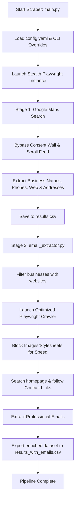

# 🗺️ LCA Scraping: Anti-Detection Google Maps & Deep Email Crawler

[](https://www.python.org/)
[](https://playwright.dev/python/)
[](https://github.com/loren-hub/lcascraping/blob/main/LICENSE)

A premium, asynchronous, two-stage scraping pipeline engineered to extract comprehensive business leads from Google Maps and perform deep crawling of target websites to retrieve contact emails and official channels. It features state-of-the-art human emulation and anti-detection engines to bypass firewalls and captchas smoothly.

---

## 🚀 Key Features

*   **🔒 Anti-Detection & Human Emulation**: 
    *   **Stealth JS Injections**: Spoofs `navigator.webdriver`, mocks native browser plugins, and overrides device language/timezone settings.
    *   **Natural Action Delay**: Implements randomized action cooldowns (configurable via `min_action_delay` and `max_action_delay`).
    *   **Dynamic Fingerprinting**: Selects from a curated pool of real browser User-Agents.
    *   **Human Mouse Movement & Scrolling**: Emulates curved mouse paths and randomized scrolling speeds to mimic human engagement.
*   **🤖 Automated Google Maps Extraction (Stage 1)**:
    *   **Auto Consent Bypass**: Automatically handles and rejects Google's intrusive cookie/consent walls.
    *   **Smart Infinite Scroll**: Continuously loads Google Maps results with termination conditions when feed limits are reached.
    *   **Data Parsing**: Extracts business names, verified telephone numbers, addresses, and homepage URLs in real-time.
*   **📧 Deep Contact & Email Crawler (Stage 2)**:
    *   **Two-Tier Search**: Explores target homepages, follows contact/about subpages (`/contact`, `/contacto`, `/about`, `/nosotros`), and extracts valid professional emails.
    *   **Performance Optimization**: Automatically drops bandwidth-heavy resources (images, video/media, custom fonts, stylesheets) during crawl, accelerating execution speed by **up to 80%** while saving bandwidth.
    *   **Incremental Data Persistence**: Saves results immediately, protecting long-running scrapers from sudden crashes.

---

## 📐 Pipeline Architecture

The workflow is cleanly split into two asynchronous stages:



---

## 📂 Project Structure

Feel free to browse through the core project files:

*   **⚡ Orchestration & Flows**:
    *   [`main.py`](file:///Users/usr/lcascraping/main.py) — The main orchestrator; parses CLI arguments and runs the Stage 1 scraper.
    *   [`search_flow.py`](file:///Users/usr/lcascraping/search_flow.py) — Handles the search interaction, cookie consent bypass, feed scrolling, and target clicking.
*   **🛠️ Extraction & Evasion Engines**:
    *   [`anti_detection.py`](file:///Users/usr/lcascraping/anti_detection.py) — Contains stealth JS hooks, curved mouse movement simulation, and slow typing emulations.
    *   [`browser_manager.py`](file:///Users/usr/lcascraping/browser_manager.py) — Manages Playwright page setups, viewports, locales, and custom User-Agent mapping.
    *   [`website_extractor.py`](file:///Users/usr/lcascraping/website_extractor.py) — Uses Beautiful Soup to parse structured JSON-LD data and fallback elements from maps.
    *   [`email_extractor.py`](file:///Users/usr/lcascraping/email_extractor.py) — Enriches scraped leads by recursively crawling homepages and contact pages for emails with advanced network interceptors.
*   **⚙️ Config & Core Utilities**:
    *   [`config.yaml`](file:///Users/usr/lcascraping/config.yaml) — Clean, comprehensive configuration file for search parameters, browser engines, and anti-detection delays.
    *   [`config.py`](file:///Users/usr/lcascraping/config.py) — Config loader and interface manager.
    *   [`data_store.py`](file:///Users/usr/lcascraping/data_store.py) — Handles real-time thread-safe persistence for CSV/JSON files.
    *   [`utils.py`](file:///Users/usr/lcascraping/utils.py) — Logging configurations, CAPTCHA detectors, and query encoders.

---

## 🛠️ Setup & Installation

Follow these quick instructions to set up the scraper locally.

### 1. Prerequisites
Ensure you have Python 3.8+ installed on your computer.

### 2. Create a Virtual Environment
Initialize a fresh virtual environment to isolate the project dependencies:
```bash
# Create the environment
python3 -m venv .venv

# Activate the environment (macOS/Linux)
source .venv/bin/activate

# Activate the environment (Windows)
# .venv\Scripts\activate
```

### 3. Install Dependencies & Playwright
Install the required packages listed in [`requirements.txt`](file:///Users/usr/lcascraping/requirements.txt) and fetch Playwright's Chromium driver:
```bash
pip install -r requirements.txt
playwright install chromium
```

---

## ⚙️ Configuration

All major settings are loaded from [`config.yaml`](file:///Users/usr/lcascraping/config.yaml). Here is an overview of the key configuration sections:

```yaml
# --- SEARCH SETTINGS ---
search:
  queries:
    - "abogados laborales en madrid"
  max_results_per_query: 30       # Total results to fetch per query
  scroll_steps_limit: 90          # Infinite scrolling depth limit

# --- ANTI-DETECTION & TIMING ---
delays:
  min_action_delay: 0.5           # Min cooldown between clicks/actions (secs)
  max_action_delay: 3.0           # Max cooldown between clicks/actions (secs)
  scroll_pause: 1.5               # Pause after scrolling to let elements load

# --- BROWSER ENGINE SETTINGS ---
browser:
  headless: false                 # Run headlessly (set false to watch the browser work)
  viewport:
    width: 1280
    height: 900
  locale: "en-US"
  timezone: "America/New_York"
```

---

## 🚀 Usage

LCA Scraping operates in two consecutive stages.

### 🔹 Unified Execution Pipeline

Execute the primary script to crawl Google Maps and automatically enrich leads with emails. Settings are loaded from `config.yaml`, but can be dynamically overridden using command-line arguments:

```bash
# Option A: Run using configurations defined in config.yaml
python3 main.py

# Option B: Run with CLI overrides (takes priority over config.yaml)
python3 main.py --queries "Pizza in Rome" "Boutique in Milan" --max-results 15 --headless
```

#### CLI Override Arguments:
*   `--queries`: Supply one or more custom search terms (separated by spaces).
*   `--max-results`: Set the maximum number of business results to extract per query.
*   `--output`: Overwrite the output filename.
*   `--format`: Choose between saving in `csv` or `json`.
*   `--headless` / `--no-headless`: Toggle background browser execution.

**Output Created**: [`results.csv`](file:///Users/usr/lcascraping/results.csv) (containing `business_name`, `business_email`, `phone`, `website`, `address`, `search_query`, `scraped_at`).


---

## 📈 Data Output Sample

The final output is stored in a clean table format:

| Business Name | Business Email | Phone | Website | Address | Search Query | Scraped At |
| :--- | :--- | :--- | :--- | :--- | :--- | :--- |
| **Abogados Madrid Sol** | `contacto@abogadosmadrid.es` | `+34 910 111 222` | `https://abogadosmadrid.es` | `Calle Mayor, 12, Madrid, Spain` | `abogados laborales en madrid` | `2026-05-17T13:51:57` |
| **Bufete del Prado** | `info@pradoabogados.com` | `+34 911 333 444` | `https://pradoabogados.com` | `Paseo del Prado, 24, Madrid, Spain` | `abogados laborales en madrid` | `2026-05-17T13:52:01` |

---

## ⚖️ License & Ethical Usage

This project is licensed under the **MIT License**. For full terms, please refer to the [`LICENSE`](file:///Users/usr/lcascraping/LICENSE) file.

> [!WARNING]
> **Ethical Web Scraping Disclaimer**: This tool is provided solely for educational and research purposes. Ensure that your scraping activities align with Google's Terms of Service and local data regulations (such as GDPR, CCPA, and COPPA). Please crawl responsibly and respect rate limits.
