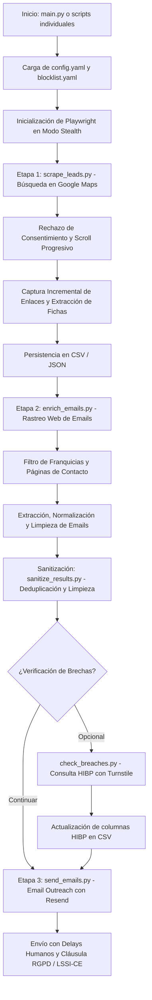

# 🗺️ LCA Scraping: Anti-Detection Google Maps, Deep Email Crawler & Breach Intelligence

[](https://www.python.org/)
[](https://playwright.dev/python/)
[](LICENSE)

Pipeline asíncrono, modular y de alto rendimiento diseñado para la prospección B2B ética, extracción de negocios locales en Google Maps, rastreo web profundo de sitios corporativos en busca de correos de contacto, verificación de brechas de seguridad (Have I Been Pwned) y ejecución de campañas de email outreach personalizadas y seguras mediante la API de Resend con estricto cumplimiento normativo (RGPD y LSSI-CE).

---

## 🚀 Características Principales

*   **🔒 Anti-Detección y Emulación Humana Avanzada**:
    *   **Inyección Stealth JS**: Modifica `navigator.webdriver`, simula plugins nativos del navegador y ajusta `languages` y zona horaria.
    *   **Trayectorias de Ratón Naturales**: Emula movimientos curvos de cursor y tiempos de pulsación realistas con variaciones gaussianas.
    *   **Pausas Aleatorias Configurables**: Delays paramétricos en cada interacción para no levantar sospechas (`min_action_delay`, `max_action_delay`).
    *   **Rotación de Huella Digital (Fingerprinting)**: Selección dinámica entre un pool curado de `User-Agent` de navegadores modernos reales.
*   **🤖 Extracción en Google Maps (Etapa 1)**:
    *   **Evasión de Virtualización de DOM**: Supera la limitación de Google Maps (que recicla elementos y solo mantiene ~10-20 nodos en memoria) capturando los enlaces de negocios incrementalmente durante cada scroll.
    *   **Salto Automático de Banners de Consentimiento**: Detecta y rechaza automáticamente los muros de cookies de Google.
    *   **Navegación Directa por URL**: Evita errores por referencias obsoletas en el DOM navegando directamente al enlace canónico de cada ficha de negocio.
*   **🏢 Filtrado Automático de Franquicias y Grandes Cadenas**:
    *   **Listas de Bloqueo Desacopladas**: Las cadenas comerciales y grandes corporaciones (ej. *Vitaldent, Adeslas, Sanitas, Mapfre*) se definen en `blocklist.yaml`, manteniendo limpia la configuración principal.
    *   **Activación Selectiva**: Filtro configurable mediante el interruptor `filtering.enabled` en `config.yaml`.
*   **📧 Rastreo Web Profundo de Emails Corporativos (Etapa 2)**:
    *   **Búsqueda en Dos Niveles**: Analiza la página de inicio y explora subpáginas habituales de contacto (`/contacto`, `/contact`, `/nosotros`, `/about`, `/aviso-legal`).
    *   **Optimización de Ancho de Banda**: Intercepta y bloquea peticiones de imágenes, vídeos, fuentes y hojas de estilo, acelerando la velocidad de rastreo hasta un **80%**.
    *   **Detección de Emails Falsos/Placeholders**: Descarta automáticamente patrones de prueba o internos (`tu@email.com`, `user@domain`, `@sentry`, `@wixpress`).
*   **🛡️ Inteligencia de Brechas con Have I Been Pwned (HIBP)**:
    *   **Auditoría de Compromiso**: Comprueba de forma independiente si los correos corporativos extraídos han formado parte de filtraciones de datos públicas conocidas.
    *   **Resolución Asistida de Cloudflare Turnstile**: Ejecución visible con soporte para resolución automática y fallback interactivo manual con aviso en terminal.
    *   **Persistencia de Sesión**: Guarda y reutiliza cookies y estado de almacenamiento (`hibp_state.json`) para mantener tokens validados.
    *   **Delays Defensivos Anti-Baneo**: Pausas largas y aleatorias (2 a 5 minutos) para respetar la infraestructura del servicio.
*   **✉️ Campañas de Outreach Personalizadas (Etapa 3 / Envío)**:
    *   **Plantillas HTML Profesionales**: Inyección dinámica de variables (nombre del negocio, datos de auditoría) en `template.html`.
    *   **Calentamiento Progresivo (Warm-up)**: Límite de envíos por ejecución (`--limit`) y pausas humanas aleatorias para proteger la reputación del dominio.
    *   **Modo Simulación (`--dry-run`)**: Permite verificar el renderizado y los destinatarios sin realizar ningún envío real.
    *   **Idempotencia Garantizada**: Marca la fecha de envío (`email_sent_at`) para evitar envíos duplicados al relanzar.
*   **🧹 Sanitización y Deduplicación Atómica (`sanitize_results.py`)**:
    *   Elimina caracteres de control y nulos (`\x00`), normaliza espacios y preserva caracteres en español.
    *   Deduplica por nombre comercial, dominio web y dirección de correo.
    *   Guarda los ficheros de forma atómica mediante archivos temporales `.tmp` y reemplazo seguro para evitar corrupciones si el proceso se interrumpe.

---

## 📐 Arquitectura del Pipeline

El flujo de trabajo se divide en fases modulares desacopladas:



---

## 📂 Estructura del Repositorio

| Archivo / Directorio | Descripción |
| :--- | :--- |
| **`main.py`** | Orquestador principal que ejecuta en serie la Etapa 1, Etapa 2 y la Sanitización de datos. |
| **`scrape_leads.py`** | Script CLI autónomo para la Etapa 1 (extracción de negocios desde Google Maps). |
| **`enrich_emails.py`** | Script CLI autónomo para la Etapa 2 (rastreo web profundo de correos de contacto). |
| **`check_breaches.py`** | Herramienta CLI de auditoría que comprueba si los correos figuran en filtraciones de Have I Been Pwned (HIBP). |
| **`send_emails.py`** | Script CLI autónomo para el envío de campañas comerciales mediante la API de Resend. |
| **`sanitize_results.py`** | Herramienta de limpieza, normalización de caracteres, exclusión de cadenas y deduplicación atómica. |
| **`browser_manager.py`** | Gestor centralizado del ciclo de vida de Playwright (stealth, viewports, storage state, headless). |
| **`search_flow.py`** | Lógica de navegación en Google Maps, superación de consent walls y scroll incremental. |
| **`website_extractor.py`** | Extractor con BeautifulSoup de datos estructurados (JSON-LD) y metadatos de Maps. |
| **`email_extractor.py`** | Motor de crawling asíncrono para homepages y páginas de contacto con interceptación de recursos. |
| **`email_sender.py`** | Lógica de renderizado de plantillas HTML, envío a través de Resend y guardado atómico. |
| **`anti_detection.py`** | Utilidades de evasión: simulación de ratón humano, tipeo lento y User-Agents aleatorios. |
| **`data_store.py`** | Capa de persistencia en tiempo real para almacenamiento thread-safe en CSV y JSON. |
| **`config.py`** | Cargador de configuración (`config.yaml`), variables de entorno (`.env`) y listas de bloqueo (`blocklist.yaml`). |
| **`utils.py`** | Funciones auxiliares para logging, detección de CAPTCHAs y codificación de URLs. |
| **`config.yaml`** | Archivo central de configuración con términos de búsqueda, límites, timeouts y parámetros de envío. |
| **`blocklist.yaml`** | Catálogo desacoplado de nombres y dominios de franquicias a excluir. |
| **`template.html`** | Plantilla HTML corporativa de outreach con diseño responsive y cláusula legal RGPD / LSSI-CE. |
| **`.env.example`** | Plantilla documentada de variables de entorno para credenciales (API keys). |

---

## 🛠️ Instalación y Requisitos

### 1. Requisitos Previos
*   Python 3.8 o superior instalado en el sistema.
*   Conexión a Internet estable.
*   (Opcional) Cuenta en [Resend](https://resend.com) si se desea ejecutar el módulo de envío de emails.

### 2. Clonar el Repositorio
```bash
git clone https://github.com/loren-hub/lcascraping.git
cd lcascraping
```

### 3. Crear y Activar el Entorno Virtual
```bash
# En macOS / Linux:
python3 -m venv .venv
source .venv/bin/activate

# En Windows:
# python -m venv .venv
# .venv\Scripts\activate
```

### 4. Instalar Dependencias y Playwright Chromium
```bash
pip install -r requirements.txt
playwright install chromium
```

### 5. Configurar Variables de Entorno
Copia la plantilla `.env.example` a `.env` y añade tu clave de API si vas a enviar correos:
```bash
cp .env.example .env
```
Edita `.env`:
```env
RESEND_API_KEY=re_tu_clave_de_resend_aqui
```

---

## ⚙️ Configuración del Proyecto

### Archivo Principal: `config.yaml`
Permite personalizar todas las etapas del scraper:

```yaml
# --- CONSULTAS DE BÚSQUEDA ---
search:
  queries:
    - "dentista near Albacete"
    - "abogado near Albacete"
  max_results_per_query: 40       # Resultados máximos a extraer por consulta
  scroll_steps_limit: 200         # Límite de pasos de scroll para cargar resultados

# --- TIEMPOS Y ANTI-DETECCIÓN ---
delays:
  min_action_delay: 0.3           # Pausa mínima entre acciones (segundos)
  max_action_delay: 1.5           # Pausa máxima entre acciones (segundos)
  scroll_pause: 1.0               # Pausa tras cada paso de scroll en Maps
  page_load_buffer: 1.0           # Espera para render de ficha de negocio
  email_page_render_wait: 1.0     # Espera para render de contenido JS en webs

# --- NAVEGADOR ---
browser:
  headless: true                  # true para ejecución en segundo plano
  viewport:
    width: 1280
    height: 900
  locale: "en-US"
  timezone: "America/New_York"

# --- FILTRADO DE FRANQUICIAS ---
filtering:
  enabled: true                   # true para aplicar los filtros de blocklist.yaml

# --- SANITIZACIÓN DE CORREOS ---
sanitization:
  fake_email_patterns:
    - "tu@email"
    - "your@email"
    - "info@example"
    - "@sentry"
  remove_rows_without_email: true # Elimina del CSV filas sin email válido

# --- ENVÍO DE CORREOS (OUTREACH) ---
email_outreach:
  sender_email: "formacion@info.lcatechnologysolutions.com"
  subject: "Campaña informativa LCA"
  template_filename: "template.html"
  delay_between_emails:
    min: 5.0
    max: 15.0

# --- AUDITORÍA DE BRECHAS (HIBP) ---
hibp:
  base_url: "https://haveibeenpwned.com"
  headless: false                 # false recomendado para resolver Turnstile
  storage_state_file: "hibp_state.json"
  turnstile_timeout: 25.0
  result_timeout: 25.0
  delay_min_seconds: 120.0        # Delays largos para evitar bloqueos
  delay_max_seconds: 300.0
```

---

## 📖 Guía de Uso

Todos los comandos pueden ejecutarse de forma conjunta mediante el orquestador principal o de forma independiente por etapas.

### 🔹 1. Pipeline Completo (`main.py`)
Ejecuta la Etapa 1 (Google Maps), la Etapa 2 (Crawling de emails) y la Sanitización de resultados:

```bash
# Ejecutar con los parámetros configurados en config.yaml
python3 main.py

# Sobrescribir consultas y límites por línea de comandos
python3 main.py --queries "Inmobiliaria en Salamanca" --max-results 15 --headless
```

---

### 🔹 2. Etapa 1: Extracción en Google Maps (`scrape_leads.py`)
Extrae únicamente los datos de las fichas de negocios (nombre, teléfono, web, dirección) y los almacena en el CSV:

```bash
python3 scrape_leads.py --queries "Dentista en Madrid" --max-results 20
```

**Parámetros disponibles:**
*   `--queries`: Lista de términos de búsqueda separados por espacio.
*   `--max-results`: Número máximo de negocios a procesar por consulta.
*   `--output`: Archivo de salida (por defecto: `results.csv`).
*   `--format`: Formato de salida (`csv` o `json`).
*   `--headless` / `--no-headless`: Alternar entre navegador en segundo plano o visible.

---

### 🔹 3. Etapa 2: Crawling Profundo de Emails (`enrich_emails.py`)
Lee el archivo de leads (`results.csv`), visita cada sitio web corporativo (y sus páginas de contacto) y extrae los correos corporativos reales:

```bash
python3 enrich_emails.py --output results.csv
```

---

### 🔹 4. Auditoría de Brechas de Seguridad (`check_breaches.py`)
Comprueba si los correos corporativos recopilados han sido comprometidos en brechas de datos conocidas consultando *Have I Been Pwned* con emulación de navegador y resolución de Cloudflare Turnstile:

```bash
# Modo interactivo visible (recomendado)
python3 check_breaches.py --output results.csv

# Verificar un lote pequeño de prueba
python3 check_breaches.py --output results.csv --limit 5

# Simulación sin escribir cambios en el CSV
python3 check_breaches.py --output results.csv --dry-run
```

> [!NOTE]
> Por defecto este comando abre una ventana visible de Chromium. Si Cloudflare Turnstile solicita resolver un desafío interactivo, la terminal avisará al operador para que haga clic en el navegador y pulse `[ENTER]` en la consola para continuar.

---

### 🔹 5. Etapa 3: Envío de Correos (`send_emails.py`)
Ejecuta la campaña de outreach por correo electrónico mediante la API de Resend utilizando la plantilla `template.html`:

```bash
# Opción A: Simulación segura (Dry Run - No envía correos ni altera el archivo)
python3 send_emails.py --output results.csv --dry-run

# Opción B: Calentamiento de dominio (Enviar un máximo de 10 correos con delays)
python3 send_emails.py --limit 10

# Opción C: Ejecución sobre archivo específico
python3 send_emails.py --output test_leads.csv --limit 5
```

---

### 🔹 6. Sanitización y Deduplicación de Leads (`sanitize_results.py`)
Limpia caracteres inválidos, elimina registros duplicados y filtra franquicias no deseadas de forma atómica:

```bash
python3 sanitize_results.py --input results.csv
```

---

## 🧪 Estrategias de Validación y Testing Seguro

El envío indiscriminado de correos en frío o el rastreo desmesurado acarrea riesgos de entregabilidad y posibles sanciones. Se recomienda seguir este protocolo antes de lanzar cualquier campaña:

1.  **Validación en Modo Simulación (`--dry-run`)**:
    Comprueba siempre el flujo de envío en modo simulación:
    ```bash
    python3 send_emails.py --output results.csv --dry-run
    ```
    Verifica en los logs que la plantilla cargada, el asunto y la sustitución de `{{business_name}}` coinciden con lo esperado.
2.  **Prueba Unitaria de Entregabilidad**:
    Crea un archivo CSV temporal con una única fila apuntando a una cuenta de correo personal bajo tu control:
    ```csv
    business_name,business_email,phone,website,address,search_query,scraped_at,email_sent_at
    Mi Negocio de Prueba,tu_correo_personal@tudominio.com,+34600000000,https://ejemplo.com,Calle Falsa 123,test,2026-05-20T17:00:00,
    ```
    Ejecuta el envío apuntando a ese archivo:
    ```bash
    python3 send_emails.py --output test_leads.csv --limit 1
    ```
    Comprueba tu bandeja de entrada y verifica:
    *   Formato y legibilidad del correo HTML en móvil y escritorio.
    *   Sustitución de etiquetas dinámicas.
    *   Presencia de la cláusula legal RGPD y la opción de baja.
    *   Comportamiento idempotente: comprueba que se ha escrito la marca de tiempo en `email_sent_at` en el archivo CSV.

---

## ⚖️ Marco Legal, Ético y Cumplimiento Normativo

Este repositorio está pensado para ser publicado en código abierto. Por este motivo, se detalla a continuación el marco regulatorio aplicable en España y la Unión Europea:

### 1. Reglamento General de Protección de Datos (RGPD - UE 2016/679)
*   **Base Jurídica**: En prospección comercial B2B hacia personas de contacto en empresas, la base habitual es el **Interés Legítimo** (Art. 6.1.f RGPD), requiriendo un juicio de ponderación previo y pertinencia directa entre la actividad ofertada y el destinatario.
*   **Deber de Información**: El correo electrónico remitido debe incluir de forma transparente los datos identificativos del responsable del tratamiento, la finalidad, el origen de los datos (fuentes accesibles al público) y las vías para ejercer los derechos ARCO/POL (acceso, rectificación, supresión, limitación y oposición).
*   **Plantilla Cumplidora**: La plantilla `template.html` incluye por defecto el bloque legal informativo exigido por el RGPD.

### 2. Ley de Servicios de la Sociedad de la Información (LSSI-CE - Ley 34/2002)
*   **Comunicaciones Comerciales Electrónicas**: De acuerdo con los Artículos 21 y 22 de la LSSI-CE, las comunicaciones comerciales electrónicas deben identificarse claramente como tales.
*   **Derecho de Oposición y Baja Gratuita**: Debe ofrecerse al destinatario una vía sencilla, directa y gratuita para solicitar la baja o revocar el consentimiento en cada comunicación (por ejemplo, respondiendo con la palabra *"BAJA"*).

### 3. Términos de Servicio de Terceros
*   **Google Maps**: El scraping automatizado de la interfaz web de Google Maps puede contravenir los Términos de Servicio de Google Maps Platform (Sección 3.2.3(a)). Este software implementa técnicas de emulación únicamente con fines de investigación técnica y formativa.
*   **Have I Been Pwned (HIBP)**: Troy Hunt proporciona una [API comercial oficial](https://haveibeenpwned.com/API/v3) para consultas a gran escala. El script de verificación de brechas de este repositorio implementa pausas deliberadas y soporte de Cloudflare Turnstile con propósitos didácticos y de auditoría interna de volumen reducido.

---

## ⚠️ Descargo de Responsabilidad (Disclaimer)

> [!CAUTION]
> **AVISO LEGAL:** Este software se proporciona "tal cual" (*as-is*), bajo licencia MIT, exclusivamente con fines **educativos, de investigación técnica en seguridad y para auditorías internas de prospección B2B ética**.
> 
> El autor y los colaboradores de este proyecto:
> 1. **No se hacen responsables** del uso indebido, abusivo o ilícito que terceros puedan realizar con esta herramienta.
> 2. **No fomentan ni respaldan** el envío masivo de correo no deseado (*SPAM*), la vulneración de las condiciones de servicio de plataformas de terceros ni el incumplimiento de la legislación vigente en materia de protección de datos (RGPD, LOPDGDD, LSSI-CE, CAN-SPAM Act o equivalentes internacionales).
> 
> El usuario final es el único y exclusivo responsable de verificar la legalidad de sus actividades, obtener las autorizaciones necesarias y garantizar el respeto a los derechos de los titulares de los datos.

---

## 📄 Licencia

Este proyecto se distribuye bajo la licencia **MIT**. Para más detalles, consulta el archivo [`LICENSE`](LICENSE).
