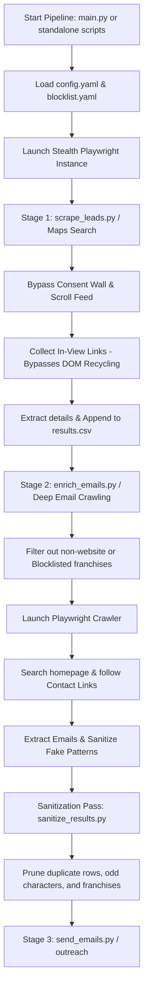

# 🗺️ LCA Scraping: Anti-Detection Google Maps & Deep Email Crawler

[](https://www.python.org/)
[](https://playwright.dev/python/)
[](https://github.com/loren-hub/lcascraping/blob/main/LICENSE)

A premium, asynchronous, multi-stage scraping pipeline engineered to extract comprehensive business leads from Google Maps, perform deep crawling of target websites to retrieve contact emails, and orchestrate fully automated template-based outreach. It features state-of-the-art human emulation, incremental virtualization bypasses, automated filtering, advanced data sanitization, and professional campaign execution with safe testing controls.

---

## 🚀 Key Features

*   **🔒 Anti-Detection & Human Emulation**: 
    *   **Stealth JS Injections**: Spoofs `navigator.webdriver`, mocks native browser plugins, and overrides device language/timezone settings.
    *   **Natural Action Delay**: Implements randomized action cooldowns (configurable via `min_action_delay` and `max_action_delay`).
    *   **Dynamic Fingerprinting**: Selects from a curated pool of real browser User-Agents.
    *   **Human Mouse Movement & Scrolling**: Emulates curved mouse paths and randomized scrolling speeds to mimic human engagement.
*   **🤖 Automated Google Maps Extraction (Stage 1)**:
    *   **DOM Virtualization Bypass**: Google Maps dynamically recycles DOM elements as you scroll, leaving only ~10 items rendered at any point. The pipeline bypasses this constraint by incrementally scanning and locking in-view business links during each scroll step.
    *   **Auto Consent Bypass**: Automatically handles and rejects Google's intrusive cookie/consent walls.
    *   **Direct-Navigation Detail Scraping**: Instead of relying on flakey elements or stale references, the pipeline processes businesses by navigating directly to their specific Google Maps detail URLs.
*   **🏢 Automated Franchise & Chain Filtering**:
    *   **Dynamic Blocklisting**: Automatically skips large chains, healthcare giants, and corporate franchises (e.g., *Vitaldent, Adeslas, Sanitas, Mapfre*).
    *   **Decoupled Blocklist Configurations**: Large blocklists are stored cleanly in a standalone [`blocklist.yaml`](file:///Users/usr/lcascraping/blocklist.yaml) file, separating raw lists from main operations config.
    *   **Category Toggles**: Easily enable or disable filtering in [`config.yaml`](file:///Users/usr/lcascraping/config.yaml) using the `filtering.enabled` toggle.
*   **📧 Deep Contact & Email Crawler (Stage 2)**:
    *   **Two-Tier Search**: Explores target homepages, follows contact/about subpages (`/contact`, `/contacto`, `/about`, `/nosotros`), and extracts valid professional emails.
    *   **Performance Optimization**: Automatically drops bandwidth-heavy resources (images, video/media, custom fonts, stylesheets) during crawl, accelerating execution speed by **up to 80%** while saving bandwidth.
    *   **Incremental Data Persistence**: Saves results immediately, protecting long-running scrapers from sudden crashes.
*   **🧹 Email Sanitization & Lead Purification**:
    *   **Placeholder Filter**: Automatically rejects dummy/placeholder emails (e.g., `tu@email.com`, `user@domain`, `admin@example`, `@sentry`).
    *   **Lead Sanitation**: Configurable to automatically drop rows that contain no valid email, outputting a high-quality list of hot outreach targets.

---

## 📐 Pipeline Architecture

The workflow is cleanly split into three asynchronous stages:



---

## 📂 Project Structure

Feel free to browse through the core project files:

*   **⚡ Orchestration & Flows**:
    *   [`main.py`](file:///Users/usr/lcascraping/main.py) — The master pipeline orchestrator; executes Stage 1 (lead scraping), Stage 2 (email enrichment), and the Sanitization pass sequentially.
    *   [`scrape_leads.py`](file:///Users/usr/lcascraping/scrape_leads.py) — Standalone command-line utility for Stage 1 (Google Maps Scraping) that appends leads to the CSV.
    *   [`enrich_emails.py`](file:///Users/usr/lcascraping/enrich_emails.py) — Standalone command-line utility for Stage 2 (Deep Website Email Crawling).
    *   [`sanitize_results.py`](file:///Users/usr/lcascraping/sanitize_results.py) — Standalone data sanitization tool that deduplicates, prunes franchises, and strips odd characters.
    *   [`send_emails.py`](file:///Users/usr/lcascraping/send_emails.py) — Standalone command-line utility to execute Stage 3 (Email Outreach) using verified Resend templates and customized target files.
    *   [`search_flow.py`](file:///Users/usr/lcascraping/search_flow.py) — Handles Maps search navigation, consent bypass, incremental scroll-based collection, and business details extraction.
*   **🛠️ Extraction & Evasion Engines**:
    *   [`anti_detection.py`](file:///Users/usr/lcascraping/anti_detection.py) — Contains stealth JS hooks, curved mouse movement simulation, and slow typing emulations.
    *   [`browser_manager.py`](file:///Users/usr/lcascraping/browser_manager.py) Manages Playwright page setups, viewports, locales, and custom User-Agent mapping.
    *   [`website_extractor.py`](file:///Users/usr/lcascraping/website_extractor.py) — Uses Beautiful Soup to parse structured JSON-LD data and fallback elements from maps.
    *   [`email_extractor.py`](file:///Users/usr/lcascraping/email_extractor.py) — Enriches scraped leads by recursively crawling homepages and contact pages for emails with advanced network interceptors, domain blocklisting, and lead sanitization.
    *   [`email_sender.py`](file:///Users/usr/lcascraping/email_sender.py) — Handles template loading, template variable substitution, and dispatches outreach campaigns using the Resend API with safe execution paths.
*   **⚙️ Config & Core Utilities**:
    *   [`config.yaml`](file:///Users/usr/lcascraping/config.yaml) — Clean, comprehensive configuration file for search parameters, delays, viewport specs, lead sanitization, and email outreach mappings.
    *   [`blocklist.yaml`](file:///Users/usr/lcascraping/blocklist.yaml) — Standalone file containing lists of blocklisted corporate names and franchise domains.
    *   [`config.py`](file:///Users/usr/lcascraping/config.py) — Config loader; loads config and dynamically merges blocklist properties if present.
    *   [`data_store.py`](file:///Users/usr/lcascraping/data_store.py) — Handles real-time thread-safe persistence for CSV/JSON files.
    *   [`utils.py`](file:///Users/usr/lcascraping/utils.py) — Logging configurations, CAPTCHA detectors, and query encoders.
*   **✉️ Email Templates**:
    *   [`template.html`](file:///Users/usr/lcascraping/template.html) — Root HTML outreach template file used for all businesses.

---

## 🛠️ Setup & Installation

Follow these quick instructions to set up the scraper locally.

### 1. Prerequisites
Ensure you have Python 3.8+ installed on your computer.

### 2. Create a Virtual Environment
Initialize a fresh virtual environment to isolate the project dependencies:
```bash
# Create the environment
python3 -m venv .venv

# Activate the environment (macOS/Linux)
source .venv/bin/activate

# Activate the environment (Windows)
# .venv\Scripts\activate
```

### 3. Install Dependencies & Playwright
Install the required packages listed in [`requirements.txt`](file:///Users/usr/lcascraping/requirements.txt) and fetch Playwright's Chromium driver:
```bash
pip install -r requirements.txt
playwright install chromium
```

---

## ⚙️ Configuration

### Core Configuration: [`config.yaml`](file:///Users/usr/lcascraping/config.yaml)
All major settings are loaded from `config.yaml`. Here is an overview of the key configuration sections:

```yaml
# --- SEARCH SETTINGS ---
search:
  queries:
    - "dentista en albacete"
  max_results_per_query: 50       # Total results to fetch per query
  scroll_steps_limit: 200         # Infinite scrolling depth limit

# --- ANTI-DETECTION & TIMING ---
delays:
  min_action_delay: 0.3           # Min cooldown between actions (secs)
  max_action_delay: 1.5           # Max cooldown between actions (secs)
  scroll_pause: 1.0               # Wait time after each scroll step (secs)
  page_load_buffer: 1.0           # Wait buffer for Maps details panel load (secs)
  email_page_render_wait: 1.0     # Wait buffer for website js content render (secs)

# --- BROWSER ENGINE SETTINGS ---
browser:
  headless: true                  # Run headlessly (set false to watch the browser work)
  viewport:
    width: 1280
    height: 900
  locale: "en-US"
  timezone: "America/New_York"

# --- FILTERING SETTINGS ---
filtering:
  enabled: true                   # Set to false to disable ALL franchise/domain filtering

# --- EMAIL SANITIZATION ---
sanitization:
  fake_email_patterns:            # Discards emails containing these substrings
    - "tu@email"
    - "your@email"
    - "info@example"
    - "test@test"
    - "@sentry"
  remove_rows_without_email: true # If true, removes rows lacking valid emails from final output

# --- EMAIL OUTREACH ---
email_outreach:
  sender_email: "info.lcatechnologysolutions.com" # Your verified Resend sender domain
  
  # Global email settings for all businesses
  subject: "Campaña informativa LCA"
  template_filename: "template.html"
```

### Franchise Configuration: [`blocklist.yaml`](file:///Users/usr/lcascraping/blocklist.yaml)
To avoid cluttering the core settings, franchise names and corporate domains are listed inside `blocklist.yaml`:

```yaml
franchise_blocklist:
  - "franchise_a"
  - "franchise_b"
  - "franchise_c"

domain_blocklist:
  - "domain_a"
  - "domain_b"
  - "domain_c"
```

---

## 🚀 Usage

The pipeline consists of modular stages that can be run end-to-end or as standalone tools.

### 🔹 Run Full Pipeline (`main.py`)

Execute the master orchestrator to run Stage 1 (Lead Extraction), Stage 2 (Email enrichment), and the Sanitization pass in sequence:

```bash
# Run pipeline using configurations defined in config.yaml
python3 main.py

# Run with CLI overrides (takes priority over config.yaml)
python3 main.py --queries "Inmobiliaria en Salamanca" --max-results 15 --headless
```

---

### 🔹 Run Stage 1: Google Maps Lead Scraper (`scrape_leads.py`)

Extract business details (names, phones, websites, addresses) without running email crawling or sanitization. Leads are automatically appended to the output file:

```bash
python3 scrape_leads.py --queries "Dentista en Madrid" --max-results 20
```

#### CLI Override Arguments:
*   `--queries`: Supply one or more custom search terms (separated by spaces).
*   `--max-results`: Set the maximum number of business results to extract per query.
*   `--output`: Overwrite the output filename (defaults to `results.csv`).
*   `--format`: Output format (`csv` or `json`).
*   `--headless` / `--no-headless`: Toggle background browser execution.

---

### 🔹 Run Stage 2: Deep Website Email Crawler (`enrich_emails.py`)

Run deep email enrichment on websites of existing leads stored in `results.csv`:

```bash
python3 enrich_emails.py --output results.csv
```

---

### 🔹 Run Lead Sanitization (`sanitize_results.py`)

Clean results, remove franchise listings, strip odd control characters, and deduplicate entries:

```bash
python3 sanitize_results.py --input results.csv
```

---

### 🔹 Stage 3: Standalone Email Outreach (`send_emails.py`)

Execute the specialized script to launch email outreach campaigns. It processes the leads generated in the previous stages, loads the configured HTML template, and safely dispatches messages:

```bash
# Option A: Dispatch outreach on the default results file defined in config.yaml
python3 send_emails.py

# Option B: Run a safe dry-run (simulation) on a custom results file
python3 send_emails.py --output test_leads.csv --dry-run
```

#### CLI Arguments for `send_emails.py`:
*   `--output`: Point to a specific lead CSV file (defaults to `output.filename` in `config.yaml` or `results.csv`).
*   `--dry-run`: Runs the email stage in simulation mode (logs actions without sending actual emails or writing timestamps to CSV).

---

## 🛡️ Safe Testing & Validation Strategies

Sending cold outreach in high volumes carries serious deliverability, validation, and programmatic risks. We strongly recommend testing the outreach flow using these safety strategies before initiating full campaigns.

### 1. Dry Run Simulation (Highly Recommended)
Before executing a campaign, run the pipeline with the `--dry-run` flag. This executes the entire email pipeline (loading results, filtering previously-contacted leads, loading the HTML template, and interpolating variables) without sending any real emails or altering your CSV file:

```bash
# Run outreach simulation on your current test_leads.csv
python3 send_emails.py --output test_leads.csv --dry-run
```

2026-05-29 12:54:59 - INFO - Starting Stage 3: Email Outreach for 1 businesses. (Dry Run: True)
2026-05-29 12:54:59 - INFO - [DRY RUN] Would send email to: rlopez.canezsolutions@gmail.com using template 'template.html'
2026-05-29 12:54:59 - INFO - [DRY RUN] Subject: Campaña informativa LCA
```

Verify that the loaded template and subject align correctly with the configuration.

### 2. Live Deliverability Verification (Single Lead Test)
To verify that the connection with Resend works, HTML variables are properly rendered, and deliverability is high (i.e., not flagged by spam filters), perform a live single-lead test:

1. Setup your Resend API key:
   ```bash
   export RESEND_API_KEY="re_your_api_key_here"
   ```
2. Create a clean test CSV file (e.g. `test_outreach.csv`) with just a single row pointing to your personal test email:
   ```csv
   business_name,business_email,phone,website,address,search_query,scraped_at,email_sent_at
   My Test Business,your_personal_email@domain.com,+34600000000,https://mytestbusiness.com,Calle Falsa 123,dentista en albacete,2026-05-20T17:00:00,
   ```
3. Run the email outreach targeting the test file:
   ```bash
   python3 send_emails.py --output test_outreach.csv
   ```
4. Check your inbox and spam folder. Verify:
   - Dynamic tag interpolation (e.g., is `{{business_name}}` replaced by `My Test Business`?).
   - Visual responsiveness and layout of the HTML body.
   - Idempotency check: Notice that the `email_sent_at` column in `test_outreach.csv` has now been populated with the sending timestamp. If you execute the command again, it will skip this lead.

---

## 📈 Data Output Sample

The final output is stored in a clean table format:

| Business Name | Business Email | Phone | Website | Address | Search Query | Scraped At | Email Sent At |
| :--- | :--- | :--- | :--- | :--- | :--- | :--- | :--- |
| **InmoHouse Albacete** | `email@address.com` | `900 600 600` | `http://www.domain.net/` | `Calle A, Spain` | `inmobiliaria en albacete` | `2026-05-19T20:31:08` | `2026-05-20T17:10:00.123456` |
| **Api Luna Albacete** | `email@address.es` | `900 600 500` | `https://www.domain.es/` | `Paseo B, Spain` | `inmobiliaria en asturias` | `2026-05-19T20:31:48` | *Pending / Empty* |

---

## ⚖️ License & Ethical Usage

This project is licensed under the **MIT License**. For full terms, please refer to the [`LICENSE`](file:///Users/usr/lcascraping/LICENSE) file.

> [!WARNING]
> **Ethical Web Scraping Disclaimer**: This tool is provided solely for educational and research purposes. Ensure that your scraping activities align with Google's Terms of Service and local data regulations (such as GDPR, CCPA, and COPPA). Please crawl responsibly and respect rate limits.
