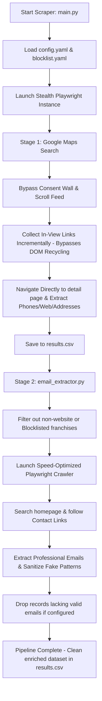

# 🗺️ LCA Scraping: Anti-Detection Google Maps & Deep Email Crawler

[](https://www.python.org/)
[](https://playwright.dev/python/)
[](https://github.com/loren-hub/lcascraping/blob/main/LICENSE)

A premium, asynchronous, multi-stage scraping pipeline engineered to extract comprehensive business leads from Google Maps and perform deep crawling of target websites to retrieve contact emails and official channels. It features state-of-the-art human emulation, incremental virtualization bypasses, automated filtering, and advanced data sanitization.

---

## 🚀 Key Features

*   **🔒 Anti-Detection & Human Emulation**: 
    *   **Stealth JS Injections**: Spoofs `navigator.webdriver`, mocks native browser plugins, and overrides device language/timezone settings.
    *   **Natural Action Delay**: Implements randomized action cooldowns (configurable via `min_action_delay` and `max_action_delay`).
    *   **Dynamic Fingerprinting**: Selects from a curated pool of real browser User-Agents.
    *   **Human Mouse Movement & Scrolling**: Emulates curved mouse paths and randomized scrolling speeds to mimic human engagement.
*   **🤖 Automated Google Maps Extraction (Stage 1)**:
    *   **DOM Virtualization Bypass**: Google Maps dynamically recycles DOM elements as you scroll, leaving only ~10 items rendered at any point. The pipeline bypasses this constraint by incrementally scanning and locking in-view business links during each scroll step.
    *   **Auto Consent Bypass**: Automatically handles and rejects Google's intrusive cookie/consent walls.
    *   **Direct-Navigation Detail Scraping**: Instead of relying on flakey elements or stale references, the pipeline processes businesses by navigating directly to their specific Google Maps detail URLs.
*   **🏢 Automated Franchise & Chain Filtering**:
    *   **Dynamic Blocklisting**: Automatically skips large chains, healthcare giants, and corporate franchises (e.g., *Vitaldent, Adeslas, Sanitas, Mapfre*).
    *   **Decoupled Blocklist Configurations**: Large blocklists are stored cleanly in a standalone [`blocklist.yaml`](file:///Users/usr/lcascraping/blocklist.yaml) file, separating raw lists from main operations config.
    *   **Category Toggles**: Easily enable or disable filtering in [`config.yaml`](file:///Users/usr/lcascraping/config.yaml) using the `filtering.enabled` toggle.
*   **📧 Deep Contact & Email Crawler (Stage 2)**:
    *   **Two-Tier Search**: Explores target homepages, follows contact/about subpages (`/contact`, `/contacto`, `/about`, `/nosotros`), and extracts valid professional emails.
    *   **Performance Optimization**: Automatically drops bandwidth-heavy resources (images, video/media, custom fonts, stylesheets) during crawl, accelerating execution speed by **up to 80%** while saving bandwidth.
    *   **Incremental Data Persistence**: Saves results immediately, protecting long-running scrapers from sudden crashes.
*   **🧹 Email Sanitization & Lead Purification**:
    *   **Placeholder Filter**: Automatically rejects dummy/placeholder emails (e.g., `tu@email.com`, `user@domain`, `admin@example`, `@sentry`).
    *   **Lead Sanitation**: Configurable to automatically drop rows that contain no valid email, outputting a high-quality list of hot outreach targets.

---

## 📐 Pipeline Architecture

The workflow is cleanly split into two asynchronous stages:



---

## 📂 Project Structure

Feel free to browse through the core project files:

*   **⚡ Orchestration & Flows**:
    *   [`main.py`](file:///Users/usr/lcascraping/main.py) — The main orchestrator; parses CLI arguments and runs the Stage 1 scraper and Stage 2 enrichment.
    *   [`search_flow.py`](file:///Users/usr/lcascraping/search_flow.py) — Handles Maps search navigation, consent bypass, incremental scroll-based collection, and business details extraction.
*   **🛠️ Extraction & Evasion Engines**:
    *   [`anti_detection.py`](file:///Users/usr/lcascraping/anti_detection.py) — Contains stealth JS hooks, curved mouse movement simulation, and slow typing emulations.
    *   [`browser_manager.py`](file:///Users/usr/lcascraping/browser_manager.py) — Manages Playwright page setups, viewports, locales, and custom User-Agent mapping.
    *   [`website_extractor.py`](file:///Users/usr/lcascraping/website_extractor.py) — Uses Beautiful Soup to parse structured JSON-LD data and fallback elements from maps.
    *   [`email_extractor.py`](file:///Users/usr/lcascraping/email_extractor.py) — Enriches scraped leads by recursively crawling homepages and contact pages for emails with advanced network interceptors, domain blocklisting, and lead sanitization.
*   **⚙️ Config & Core Utilities**:
    *   [`config.yaml`](file:///Users/usr/lcascraping/config.yaml) — Clean, comprehensive configuration file for search parameters, delays, viewport specs, and lead sanitization patterns.
    *   [`blocklist.yaml`](file:///Users/usr/lcascraping/blocklist.yaml) — Standalone file containing lists of blocklisted corporate names and franchise domains.
    *   [`config.py`](file:///Users/usr/lcascraping/config.py) — Config loader; loads config and dynamically merges blocklist properties if present.
    *   [`data_store.py`](file:///Users/usr/lcascraping/data_store.py) — Handles real-time thread-safe persistence for CSV/JSON files.
    *   [`utils.py`](file:///Users/usr/lcascraping/utils.py) — Logging configurations, CAPTCHA detectors, and query encoders.

---

## 🛠️ Setup & Installation

Follow these quick instructions to set up the scraper locally.

### 1. Prerequisites
Ensure you have Python 3.8+ installed on your computer.

### 2. Create a Virtual Environment
Initialize a fresh virtual environment to isolate the project dependencies:
```bash
# Create the environment
python3 -m venv .venv

# Activate the environment (macOS/Linux)
source .venv/bin/activate

# Activate the environment (Windows)
# .venv\Scripts\activate
```

### 3. Install Dependencies & Playwright
Install the required packages listed in [`requirements.txt`](file:///Users/usr/lcascraping/requirements.txt) and fetch Playwright's Chromium driver:
```bash
pip install -r requirements.txt
playwright install chromium
```

---

## ⚙️ Configuration

### Core Configuration: [`config.yaml`](file:///Users/usr/lcascraping/config.yaml)
All major settings are loaded from `config.yaml`. Here is an overview of the key configuration sections:

```yaml
# --- SEARCH SETTINGS ---
search:
  queries:
    - "dentista en albacete"
  max_results_per_query: 50       # Total results to fetch per query
  scroll_steps_limit: 200         # Infinite scrolling depth limit

# --- ANTI-DETECTION & TIMING ---
delays:
  min_action_delay: 0.3           # Min cooldown between actions (secs)
  max_action_delay: 1.5           # Max cooldown between actions (secs)
  scroll_pause: 1.0               # Wait time after each scroll step (secs)
  page_load_buffer: 1.0           # Wait buffer for Maps details panel load (secs)
  email_page_render_wait: 1.0     # Wait buffer for website js content render (secs)

# --- BROWSER ENGINE SETTINGS ---
browser:
  headless: true                  # Run headlessly (set false to watch the browser work)
  viewport:
    width: 1280
    height: 900
  locale: "en-US"
  timezone: "America/New_York"

# --- FILTERING SETTINGS ---
filtering:
  enabled: true                   # Set to false to disable ALL franchise/domain filtering

# --- EMAIL SANITIZATION ---
sanitization:
  fake_email_patterns:            # Discards emails containing these substrings
    - "tu@email"
    - "your@email"
    - "info@example"
    - "test@test"
    - "@sentry"
  remove_rows_without_email: true # If true, removes rows lacking valid emails from final output
```

### Franchise Configuration: [`blocklist.yaml`](file:///Users/usr/lcascraping/blocklist.yaml)
To avoid cluttering the core settings, franchise names and corporate domains are listed inside `blocklist.yaml`:

```yaml
franchise_blocklist:
  - "franchise_a"
  - "franchise_b"
  - "franchise_c"

domain_blocklist:
  - "domain_a"
  - "domain_b"
  - "domain_c"
```

---

## 🚀 Usage

LCA Scraping operates in two consecutive stages.

### 🔹 Unified Execution Pipeline

Execute the primary script to crawl Google Maps and automatically enrich leads with emails. Settings are loaded from `config.yaml`, but can be dynamically overridden using command-line arguments:

```bash
# Option A: Run using configurations defined in config.yaml
python3 main.py

# Option B: Run with CLI overrides (takes priority over config.yaml)
python3 main.py --queries "Inmobiliaria en Salamanca" --max-results 15 --headless
```

#### CLI Override Arguments:
*   `--queries`: Supply one or more custom search terms (separated by spaces).
*   `--max-results`: Set the maximum number of business results to extract per query.
*   `--output`: Overwrite the output filename.
*   `--format`: Choose between saving in `csv` or `json`.
*   `--headless` / `--no-headless`: Toggle background browser execution.

**Output Created**: [`results.csv`](file:///Users/usr/lcascraping/results.csv) (containing `business_name`, `business_email`, `phone`, `website`, `address`, `search_query`, `scraped_at`).

---

## 📈 Data Output Sample

The final output is stored in a clean table format:

| Business Name | Business Email | Phone | Website | Address | Search Query | Scraped At |
| :--- | :--- | :--- | :--- | :--- | :--- | :--- |
| **InmoHouse Albacete** | `email@address.com` | `900 600 600` | `http://www.domain.net/` | `Calle A, Spain` | `inmobiliaria en albacete` | `2026-05-19T20:31:08` |
| **Api Luna Albacete** | `email@address.es` | `900 600 500` | `https://www.domain.es/` | `Paseo B, Spain` | `inmobiliaria en asturias` | `2026-05-19T20:31:48` |

---

## ⚖️ License & Ethical Usage

This project is licensed under the **MIT License**. For full terms, please refer to the [`LICENSE`](file:///Users/usr/lcascraping/LICENSE) file.

> [!WARNING]
> **Ethical Web Scraping Disclaimer**: This tool is provided solely for educational and research purposes. Ensure that your scraping activities align with Google's Terms of Service and local data regulations (such as GDPR, CCPA, and COPPA). Please crawl responsibly and respect rate limits.
